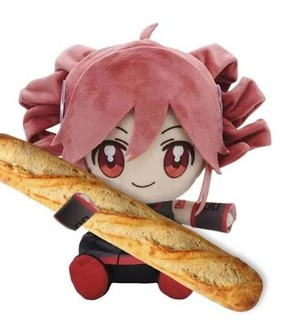

<p align="center">
  
</p>

<h1 align="center">Baguette</h1>

<p align="center">A cute little FTP, FTPS and SFTP client for Windows 🥖</p>

> The names and the design are a work in progress, nothing here is final yet.

## Use it

Open `Baguette.exe`, add a site (or type an address in Quick connect) and drag files between your
PC and the server.

- Tabs, saved sites, drag and drop to and from Explorer, open and edit files in place
- `--simple` opens a window with just the server's files
- Portable: settings stay next to `Baguette.exe`, passwords are encrypted for your Windows account
- An option saves `.bmp` pictures as `.png` when they arrive

## With a 3DS (optional)

Run [**Cement**](https://github.com/Synaelle/cement) on the 3DS and connect to the address it shows.
Baguette then also shows the battery, the SD card, Send to PC and the CIAs to install.

`baguette-cli.exe` talks to Cement from scripts:

```
baguette-cli status                          battery, SD space, busy or not
baguette-cli put game/ sd:/3ds/app           upload
baguette-cli --png get sd:/luma/screenshots  download, BMP saved as PNG
baguette-cli --help                          everything else
```

`add-to-path.bat` lets you type `baguette` in any terminal.

## Build

Rust (MSVC) and the Visual Studio Build Tools, then `build.bat`.

## Planned

- Updating from within the app
- Tools for PS3, Xbox 360 (Aurora) and Switch
- Full support for macOS, Linux and Android

## License

GPL-3.0 or later, see [LICENSE](LICENSE).
